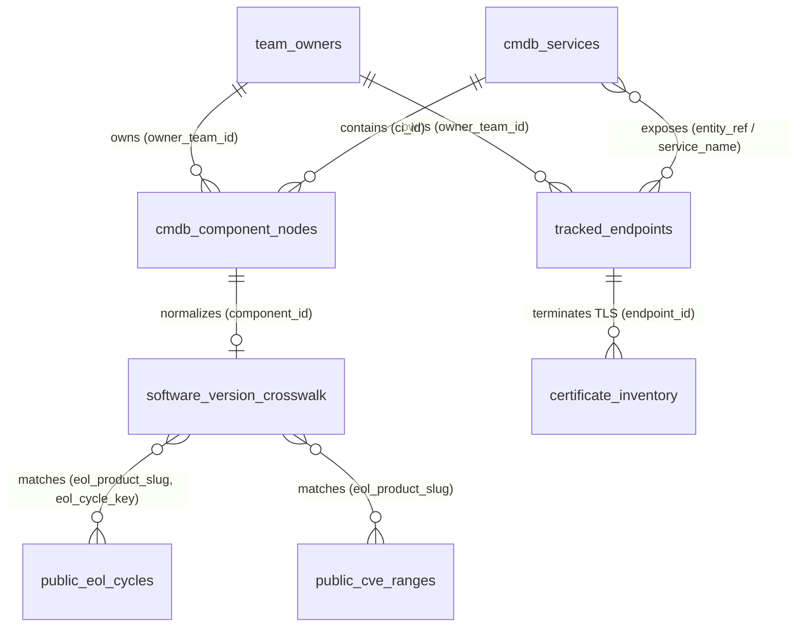

# Project Aegis 🛡️ — Deep Architectural Analysis & Master LLM Recreation Prompt

This document contains:
1. **Part I — Deep Architectural Analysis of Project Aegis:** A complete structural breakdown of how Project Aegis transforms a baseline Spotify Backstage installation into an Autonomous Internal Developer Platform (IDP), Living CMDB, Multi-Environment SSL/TLS Compliance Engine, and Infrahub Attack-Path Security Portal.
2. **Part II — The Complete Copy-Paste Master Prompt for an LLM:** A self-contained, zero-ambiguity specification prompt designed to allow an LLM to recreate **100% of Project Aegis from a base Backstage installation**, including exact file paths, `package.json` dependencies, PostgreSQL 9-table DDL & Knex reconciliation, Infrahub GraphQL + attack-vector graph seeds, all 10 backend plugins, all 11 frontend modules (5 Unified Inventory pages + 9 Catalog Entity Cards + Sidebar + Home widgets), 4 Scaffolder templates, the standalone Python FastAPI SSL microservice, and the local K3s/Podman/HAProxy/Harbor sandboxes.

---

## Part I: Deep Architectural Analysis of Project Aegis

### 1. System Topology & Core Design Principles
Project Aegis is built on **Spotify Backstage** (Node 22+, Yarn 4.13, TypeScript 5.8) and Python 3.12 (FastAPI + SQLAlchemy 2.0):
- **Backstage New Backend System (`@backstage/backend-defaults` & `@backstage/backend-plugin-api`):** Modular backend plugins, catalog processors, and scaffolder actions wired in `portal/packages/backend/src/index.ts`.
- **Backstage New Frontend System (`@backstage/frontend-defaults` & `@backstage/frontend-plugin-api`):** Declarative blueprints (`EntityCardBlueprint`, `PageBlueprint`, `NavContentBlueprint`, `HomePageWidgetBlueprint`) wired in `portal/packages/app/src/App.tsx`.
- **100% PostgreSQL Persistence (`pg` + Knex + SQLAlchemy):** PostgreSQL is the primary database for both Backstage core plugins (`catalog`, `scaffolder`, `auth`, `search-backend-module-pg`) and Project Aegis's **9 canonical operational tables** (`aegisPostgresStore.ts` & `demo/db-init/init.sql`), with automatic schema initialization, idempotent `.onConflict().merge()` seeding, and graceful offline fallback when PostgreSQL is unreachable during isolated unit tests.
- **Infrahub as Graph/AI Brain + Backstage Tech-Insights as Thin Scorecard Projector:** N-hop attack-path graph traversals and temporal infrastructure branch queries are modeled around **Infrahub** (via GraphQL + `infrahub-mcp`), while Backstage retrieves 6 pre-computed summary facts per service to evaluate pass/fail Tech-Insights scorecards and interactive "What-If" remediation simulations.
- **GitOps-First & Shift-Left Guardrails:** Every Day-2 operation (HAProxy TLS rotation, GCP Load Balancer certificate auto-renewal, Private Cloud LB weak-crypto remediation, Kubernetes scaling/restarts) enforces pre-flight OPA/Quality Gate checks, generates unified `--- Before` / `+++ After` diffs, and synchronizes changes back to GitOps manifests.

### 2. Complete Repository File Tree to Recreate
```text
proj-aegis/
├── aegis_readme.md
├── requirements.txt                      # Pinned Python prod dependencies (FastAPI, SQLAlchemy, cryptography)
├── requirements-dev.txt                  # Pinned Python test dependencies (pytest, pytest-cov, httpx)
├── secure-check.sh                       # Offline security sweep (Gitleaks, Semgrep, Syft, Grype, ClamAV)
├── services/
│   └── ssl_tracker/                      # Standalone Python FastAPI SSL Compliance Microservice
│       ├── __init__.py
│       ├── config.py                     # Fail-fast env loader, MaskedSecret & SecretRedactingFilter
│       ├── models.py                     # SQLAlchemy 2.0 ORM models & Pydantic v2 schemas
│       ├── database.py                   # PostgreSQL/SQLite engine factory & rotation lineage upsert
│       ├── compliance.py                 # 5-pillar X.509 compliance engine (cryptography.x509)
│       ├── scanner.py                    # ProviderAdapterRegistry (haproxy-edge, private-cloud-lb, gcp-cloud-lb)
│       ├── active_prober.py              # Live TLS prober, WAF fingerprinting & Zscaler CIDR classifier
│       └── app.py                        # FastAPI routes (/healthz, /api/v1/scan, /probe-active, /metrics, etc.)
├── tests/                                # Python pytest test suite
│   ├── unit/
│   │   ├── test_config.py
│   │   ├── test_compliance.py
│   │   └── test_active_prober.py
│   ├── integration/
│   │   └── test_database_and_scanner.py
│   └── e2e/
│       └── test_api.py
├── demo/                                 # Local Microservices, K8s Manifests & HAProxy/Harbor Sandboxes
│   ├── catalog-info.yaml                 # Master Location importing all 6 demo catalog files
│   ├── docker-compose.yml                # Postgres 15, auth (:3001), backend (:3002), ui (:8080)
│   ├── k8s/manifest.yaml                 # K3s Deployments & NodePort Services (30001, 30002, 30080)
│   ├── db-init/
│   │   ├── init.sql                      # Canonical PostgreSQL DDL & initial seed for all 9 tables
│   │   └── catalog-info.yaml             # Resource: aegis-db
│   ├── org/catalog-info.yaml             # Groups: team-aegis, app-team, sre-team
│   ├── ui/                               # Component: aegis-ui + static SPA & TechDocs
│   ├── auth/                             # Component: aegis-auth + Express JWT server (:3001) & TechDocs
│   ├── backend/                          # Component: aegis-backend + Express/PG server (:3002) & TechDocs
│   ├── haproxy/                          # Component: hello-world-app & Resource: haproxy-hello-world-tls
│   │   ├── haproxy.cfg                   # TLS termination (:8443/:443) + Runtime Admin Socket
│   │   ├── hello-server.js               # Upstream Node HTTP server (:8080) with /healthz
│   │   ├── start-sandbox.sh              # Podman builder & 15-day self-signed PEM initializer
│   │   └── catalog-info.yaml
│   └── harbor/
│       ├── harbor-server.js              # Mock Harbor v2 Registry API (:8880)
│       └── start-harbor-sandbox.sh
└── portal/                               # Backstage Monorepo (Node 22+, Yarn 4.13)
    ├── app-config.yaml                   # PostgreSQL DB config, catalog locations, K8s & TechDocs config
    ├── package.json
    ├── examples/
    │   ├── haproxy-tls-template/template.yaml
    │   ├── gcp-lb-tls-template/template.yaml
    │   ├── k8s-day2-ops-template/template.yaml
    │   └── ciam-service-template/template.yaml
    └── packages/
        ├── backend/
        │   ├── package.json
        │   └── src/
        │       ├── index.ts              # Registers core Backstage backend plugins + 10 Aegis modules
        │       └── modules/
        │           ├── aegisPostgresStore.ts
        │           ├── infrahubAttackGraphService.ts
        │           ├── infrahubAttackGraphModule.ts
        │           ├── livingCmdbService.ts
        │           ├── livingCmdbModule.ts
        │           ├── softwareVersionNormalizerService.ts
        │           ├── sslEndpointTrackerService.ts
        │           ├── sslEndpointTrackerModule.ts
        │           ├── activeEndpointProberService.ts
        │           ├── domainCsvImporterService.ts
        │           ├── haproxyTlsService.ts
        │           ├── haproxyTlsModule.ts
        │           ├── k8sDay2OpsService.ts
        │           ├── k8sDay2OpsModule.ts
        │           ├── cveIntelligenceService.ts
        │           ├── cveIntelligenceModule.ts
        │           ├── harborEolService.ts
        │           ├── harborEolModule.ts
        │           ├── gcpCloudPostureService.ts
        │           ├── gcpCloudPostureModule.ts
        │           ├── infraQualityGateService.ts
        │           ├── infraQualityGateModule.ts
        │           ├── ciamTokenService.ts
        │           ├── ciamTokenModule.ts
        │           └── *.test.ts         # 12 comprehensive backend Jest unit test suites
        └── app/
            ├── package.json
            └── src/
                ├── App.tsx               # createApp({ features: [...] }) with New Frontend System
                └── modules/
                    ├── nav/              # Sidebar.tsx with Unified Inventory links & custom logos
                    ├── home/             # GettingStarted & RandomJoke HomePageWidgetBlueprints
                    ├── unifiedInventory/ # 5 PageBlueprints (/inventory/domains, software, infrastructure, teams, attack-paths)
                    ├── infrahubAttackGraph/
                    ├── livingCmdb/
                    ├── sslTracker/
                    ├── tls/
                    ├── k8sOps/
                    ├── cveIntel/
                    ├── harborEol/
                    ├── gcpPosture/
                    ├── quality/
                    └── ciamToken/
```

---

## Part II: Master Prompt to Recreate Project Aegis from a Base Backstage Installation

Copy and paste the entire prompt block below into an LLM coding agent to recreate Project Aegis from a vanilla Backstage installation.

````markdown
# ROLE & OBJECTIVE
You are a Principal Platform & Security Architect. Starting from a baseline Spotify Backstage installation (`portal/` using Node.js 22+, Yarn 4, TypeScript 5.8), transform the repository into **Project Aegis** — the Internal Developer Platform (IDP), Autonomous Living CMDB, Multi-Environment SSL/TLS Compliance Engine, and Infrahub Attack-Path Security Portal for a Customer Identity & Access Management (CIAM) ecosystem.

Follow every specification below verbatim. Do not use placeholders or stubbed logic. Every service must include deterministic seed data and offline fallback behavior so that all backend tests, frontend tests, and live UI interactions succeed even when external containers or databases are offline.

---

## STEP 0: BASE BACKSTAGE PREPARATION & DEPENDENCY WIRING

### 0.1 Required Frontend & Backend Packages
Ensure `portal/packages/backend/package.json` includes:
- `@backstage/backend-defaults`, `@backstage/backend-plugin-api`, `@backstage/catalog-model`, `@backstage/config`
- `@backstage/plugin-app-backend`, `@backstage/plugin-proxy-backend`, `@backstage/plugin-scaffolder-backend`, `@backstage/plugin-scaffolder-backend-module-github`, `@backstage/plugin-scaffolder-backend-module-notifications`, `@backstage/plugin-scaffolder-node`
- `@backstage/plugin-techdocs-backend`, `@backstage/plugin-auth-backend`, `@backstage/plugin-auth-backend-module-guest-provider`, `@backstage/plugin-auth-node`
- `@backstage/plugin-catalog-backend`, `@backstage/plugin-catalog-backend-module-scaffolder-entity-model`, `@backstage/plugin-catalog-backend-module-logs`, `@backstage/plugin-catalog-node`
- `@backstage/plugin-permission-backend`, `@backstage/plugin-permission-backend-module-allow-all-policy`
- `@backstage/plugin-search-backend`, `@backstage/plugin-search-backend-module-pg`, `@backstage/plugin-search-backend-module-catalog`, `@backstage/plugin-search-backend-module-techdocs`
- `@backstage/plugin-kubernetes-backend`, `@backstage/plugin-user-settings-backend`, `@backstage/plugin-notifications-backend`, `@backstage/plugin-signals-backend`, `@backstage/plugin-mcp-actions-backend`
- `"pg": "^8.11.3"`, `"better-sqlite3": "^12.0.0"`

Ensure `portal/packages/app/package.json` uses the **Backstage New Frontend System**:
- `@backstage/frontend-defaults`, `@backstage/frontend-plugin-api`, `@backstage/core-components`, `@backstage/core-plugin-api`, `@backstage/ui`
- `@backstage/plugin-app-react`, `@backstage/plugin-catalog` (`/alpha`), `@backstage/plugin-catalog-react` (`/alpha`), `@backstage/plugin-home-react` (`/alpha`), `@backstage/plugin-notifications` (`/alpha`), `@backstage/plugin-scaffolder`, `@backstage/plugin-search`, `@backstage/plugin-user-settings`, `@material-ui/core`, `@material-ui/icons`

### 0.2 Backend Entrypoint (`portal/packages/backend/src/index.ts`)
Wire `createBackend()` from `@backstage/backend-defaults` with all standard Backstage plugins (including `@backstage/plugin-search-backend-module-pg` and `@backstage/plugin-kubernetes-backend`) plus all **10 Project Aegis backend modules/plugins**:
```ts
import { catalogModuleHaproxyTls, resiliencyTlsPlugin, scaffolderModuleHaproxyTls } from './modules/haproxyTlsModule';
import { catalogModuleK8sDay2Ops, resiliencyK8sPlugin, scaffolderModuleK8sDay2Ops } from './modules/k8sDay2OpsModule';
import { catalogModuleSslEndpointTracker, scaffolderModuleSslEndpointTracker, sslEndpointTrackerPlugin } from './modules/sslEndpointTrackerModule';
import { ciamTokenPlugin, scaffolderModuleCiamToken } from './modules/ciamTokenModule';
import { harborEolPlugin } from './modules/harborEolModule';
import { gcpCloudPosturePlugin } from './modules/gcpCloudPostureModule';
import { livingCmdbPlugin } from './modules/livingCmdbModule';
import { cveIntelligencePlugin } from './modules/cveIntelligenceModule';
import { infraQualityGatePlugin } from './modules/infraQualityGateModule';
import { infrahubAttackGraphPlugin } from './modules/infrahubAttackGraphModule';
```

### 0.3 Frontend Entrypoint (`portal/packages/app/src/App.tsx`)
Wire `createApp()` from `@backstage/frontend-defaults` with:
```ts
export default createApp({
  features: [
    catalogPlugin,
    navModule,
    homeModule,
    qualityModule,
    tlsModule,
    k8sOpsModule,
    sslTrackerModule,
    ciamTokenModule,
    harborEolModule,
    gcpPostureModule,
    livingCmdbModule,
    cveIntelModule,
    infrahubAttackGraphModule,
    unifiedInventoryPlugin,
    notificationsPlugin,
  ],
});
```

---

## STEP 1: POSTGRESQL MAIN DATABASE ARCHITECTURE (CORE + 9 CANONICAL TABLES)

### 1.1 Backstage Configuration (`portal/app-config.yaml`)
Configure Backstage to use **PostgreSQL (`client: pg`)** as its primary database:
- `app.title`: `"Aegis Unified Inventory Portal"`
- `app.baseUrl`: `http://localhost:3003`
- `app.extensions`: mount `- page:catalog` at `path: /`, and configure `page:home` widgets (`HomePageSearchBar`, `GettingStarted`, `HomePageStarredEntities`, `HomePageRandomJoke`, `HomePageToolkit`, `HomePageWorldClock`, `HomePageMostVisited`, `HomePageRecentlyVisited`).
- `backend.baseUrl`: `http://localhost:7007`, `backend.listen.port`: `7007`, `backend.cors.origin`: `http://localhost:3003`
- `backend.database`:
  ```yaml
  database:
    client: pg
    connection:
      host: 10.43.73.79
      port: 5432
      user: user
      password: password
  ```
- `techdocs`: `builder: 'local'`, `generator.runIn: 'local'`, `publisher.type: 'local'`
- `catalog.rules`: `allow: [Component, System, API, Resource, Location, Group, User]`
- `catalog.locations`: register `../../../demo/catalog-info.yaml`, `../../examples/entities.yaml`, `../../examples/org.yaml`, and the 4 templates (`haproxy-tls-template`, `gcp-lb-tls-template`, `k8s-day2-ops-template`, `ciam-service-template`).
- `kubernetes`: `multiTenant` service locator with config cluster `local-k3s` (`https://127.0.0.1:6443`, `authProvider: 'serviceAccount'`, `skipTLSVerify: true`, `serviceAccountToken: ${K8S_SERVICE_ACCOUNT_TOKEN}`).

### 1.2 Canonical 9-Table PostgreSQL Schema & Knex Store (`demo/db-init/init.sql` & `portal/packages/backend/src/modules/aegisPostgresStore.ts`)
Implement `initializeAegisPostgresSchema(knex)`, `syncSslEndpointsWithPostgres(knex)`, `queryEntityCmdbSnapshotFromPostgres(entityRef, knex)`, `queryFleetCmdbTopologyFromPostgres(knex)`, and `getAegisPostgresTableCounts(knex)` in `aegisPostgresStore.ts`.

#### Entity-Relationship Model across the 9 PostgreSQL Tables


#### Complete 9-Table DDL Specification
1. **`items`**:
   - `id SERIAL PRIMARY KEY`, `name VARCHAR(100)`, `status VARCHAR(50)`
   - Seed: `{ name: 'Auth', status: 'Online' }` if empty.
2. **`team_owners`**:
   - `team_id VARCHAR(32) PRIMARY KEY` (`'app-team'` | `'sre-team'`)
   - `team_name VARCHAR(128) NOT NULL` (`'App Team'` | `'SRE Team'`)
   - `responsibility_scope VARCHAR(255) NOT NULL`
   - `email VARCHAR(128) NOT NULL`
   - `slack_channel VARCHAR(64) NOT NULL`
3. **`tracked_endpoints`**:
   - `id SERIAL PRIMARY KEY`
   - `endpoint_uid VARCHAR(255) UNIQUE` (`${entityRef}:${environment}:${endpointKey}`)
   - `endpoint_name VARCHAR(255) NOT NULL` (SNI Hostname / FQDN)
   - `protocol VARCHAR(32) NOT NULL` (`'HTTPS'`)
   - `port INTEGER NOT NULL` (`443`, `8443`, `5432`)
   - `owner_team_id VARCHAR(32) NOT NULL REFERENCES team_owners(team_id)`
   - `environment VARCHAR(64)` (`'dev' | 'stg' | 'stress-test' | 'preprod' | 'prod'`)
   - `notes TEXT`, `entity_ref VARCHAR(255)`, `service_name VARCHAR(255)`, `endpoint_key VARCHAR(128)`, `endpoint_url VARCHAR(512)`, `sni_hostname VARCHAR(255)`
   - `provider_type VARCHAR(64)` (`'gcp-cloud-lb' | 'private-cloud-lb' | 'haproxy-edge'`)
   - `renewal_mode VARCHAR(64)` (`'workflow-auto-renew' | 'self-renewing-monitored' | 'manual-or-template'`)
   - `exposure_scope VARCHAR(64)`, `dns_scope VARCHAR(64)`, `ingress_type VARCHAR(128)`
   - `auto_renew_threshold_days INTEGER`, `gcp_project VARCHAR(128)`, `gcp_target_proxy VARCHAR(128)`, `last_probed_at TIMESTAMP`
4. **`certificate_inventory`**:
   - `id SERIAL PRIMARY KEY`
   - `endpoint_id INTEGER NOT NULL REFERENCES tracked_endpoints(id) ON DELETE CASCADE`
   - `cert_issuer VARCHAR(255)`, `cert_subject VARCHAR(255)`, `serial_number VARCHAR(128)`
   - `not_before TIMESTAMP`, `not_after TIMESTAMP`, `key_algorithm VARCHAR(64)`, `key_size INTEGER`
   - `auto_renew BOOLEAN DEFAULT FALSE`, `notes TEXT`
   - `compliance_status VARCHAR(32)`, `days_remaining INTEGER`, `is_active BOOLEAN DEFAULT TRUE`, `cert_details_json JSONB`
   - `UNIQUE (endpoint_id, serial_number)`
5. **`cmdb_services`**:
   - `ci_id VARCHAR(64) PRIMARY KEY` (`'CI-AEGIS-1001'`..`'CI-AEGIS-1005'`)
   - `entity_ref VARCHAR(255) NOT NULL`, `service_name VARCHAR(255) NOT NULL`, `owner_team VARCHAR(128)`
   - `declared_exposure_tier VARCHAR(32)`, `observed_exposure_tier VARCHAR(32)`
   - `declared_replicas INTEGER`, `observed_replicas INTEGER`
   - `declared_image_digest VARCHAR(255)`, `observed_image_digest VARCHAR(255)`
   - `drift_status VARCHAR(32)` (`'IN_SYNC' | 'DRIFT_DETECTED'`)
   - `drift_items JSONB`, `blast_radius JSONB`, `last_reconciled_at TIMESTAMP`
6. **`cmdb_component_nodes`**:
   - `component_id VARCHAR(64) PRIMARY KEY`
   - `ci_id VARCHAR(64) NOT NULL REFERENCES cmdb_services(ci_id) ON DELETE CASCADE`
   - `domain VARCHAR(128)` (`'INFRASTRUCTURE' | 'SOFTWARE'`)
   - `layer_id VARCHAR(64)`, `layer_label VARCHAR(128)`
   - `category_type VARCHAR(64)`, `category_label VARCHAR(128)`, `icon VARCHAR(32)`
   - `owner_team_id VARCHAR(32) REFERENCES team_owners(team_id)`
   - `name VARCHAR(255)`, `version_or_identifier VARCHAR(128)`, `status VARCHAR(32)`, `notes TEXT`
7. **`software_version_crosswalk`**:
   - `component_id VARCHAR(64) PRIMARY KEY REFERENCES cmdb_component_nodes(component_id) ON DELETE CASCADE`
   - `purl VARCHAR(512)`, `cpe23_uri VARCHAR(255)`
   - `eol_product_slug VARCHAR(128)`, `eol_cycle_key VARCHAR(128)`, `eol_cycle_strategy VARCHAR(64)`, `eol_api_url VARCHAR(512)`, `vendor_lifecycle_stream VARCHAR(128)`
   - `osv_ecosystem VARCHAR(64)`, `osv_package_name VARCHAR(255)`, `nvd_cpe_match_string VARCHAR(255)`, `ghsa_ecosystem VARCHAR(64)`, `distro_advisory_namespace VARCHAR(128)`
   - `semver_sort_tuple INT[]`
8. **`public_eol_cycles`**:
   - `eol_product_slug VARCHAR(128) NOT NULL`, `cycle VARCHAR(64) NOT NULL`, `PRIMARY KEY (eol_product_slug, cycle)`
   - `is_lts BOOLEAN DEFAULT FALSE`, `release_date DATE`, `active_support_end_date DATE`, `eol_date DATE`, `latest_patch_version VARCHAR(64)`
9. **`public_cve_ranges`**:
   - `cve_id VARCHAR(32) PRIMARY KEY`, `eol_product_slug VARCHAR(128)`, `distro_advisory_namespace VARCHAR(128)`
   - `introduced_version VARCHAR(64)`, `fixed_version VARCHAR(64)`
   - `cvss_v3_score NUMERIC(3,1)`, `epss_score NUMERIC(5,4)`, `is_cisa_kev BOOLEAN DEFAULT FALSE`, `advisory_source VARCHAR(128)`

#### Schema Guard & Bidirectional Sync Rules in `aegisPostgresStore.ts`
- Before creating tables, check if `team_owners` is missing `team_id` or `cmdb_services` is missing `ci_id`; if so, drop the 8 Aegis tables in reverse FK dependency order and recreate them cleanly.
- Seed `team_owners`, `public_eol_cycles`, `public_cve_ranges`, `cmdb_services`, `cmdb_component_nodes`, and `software_version_crosswalk` idempotently using `.onConflict(...).merge()`.
- In `syncSslEndpointsWithPostgres(knex)`:
  1. Upsert all in-memory non-`imported-*` endpoints from `getFleetSslInventory().endpoints` into `tracked_endpoints` (`.onConflict('endpoint_uid').merge()`) and their active certificates into `certificate_inventory` (`.onConflict(['endpoint_id', 'serial_number']).merge()`).
  2. Read all rows from `tracked_endpoints` in PostgreSQL, backfill `endpoint_uid` if null (`${entityRef}:${env}:imported-${row.id}`), load the active certificate from `certificate_inventory`, call `hydrateTrackedEndpointRecordFromDbRow(...)`, and prune any in-memory `imported-*` endpoints that were deleted from PostgreSQL.

---

## STEP 2: INFRAHUB INTEGRATION, EXPLICIT ATTACK-VECTOR MAPPING & TECH-INSIGHTS SCORECARD PROJECTOR

### 2.1 Backend Service & Plugin (`infrahubAttackGraphService.ts` & `infrahubAttackGraphModule.ts`)
Create `infrahubAttackGraphPlugin` (`pluginId: 'infrahub-attack-graph'`) and `infrahubAttackGraphService.ts`.

#### Attack-Vector Graph Node & Directed Edge Types
```ts
export type AttackGraphNodeType =
  | 'EXPOSED_HTTPS_DOMAIN'
  | 'SSL_TLS_CERTIFICATE'
  | 'COMPUTE_HOST_OR_POD'
  | 'EOL_RUNTIME_OR_OS'
  | 'SBOM_PACKAGE'
  | 'CVE_VULNERABILITY'
  | 'LATERAL_SERVICE_OR_DATA_STORE';

export type AttackGraphEdgeType =
  | 'EXPOSES_INGRESS'
  | 'TERMINATES_TLS_WITH'
  | 'ROUTES_TO_WORKLOAD'
  | 'EXECUTES_ON_RUNTIME'
  | 'IMPORTS_SBOM_PACKAGE'
  | 'AFFECTED_BY_CVE'
  | 'REACHABLE_HOT_PATH_TO'
  | 'LATERAL_MOVEMENT_TO_DATA';
```

#### Infrahub GraphQL Facts Query (`INFRAHUB_GRAPHQL_FACTS_QUERY`)
```graphql
query TechInsightsFacts($serviceKey: String!) {
  service(key: $serviceKey) {
    key
    name
    exposedDomains {
      count
    }
    sslCertificates {
      nonCompliantCount
    }
    sbomPackages {
      eolCount
    }
    cveVulnerabilities {
      reachableKevCount
    }
    lateralDataPaths {
      reachableCount
    }
    attackPathRiskScore
  }
  attackGraphEdges(serviceKey: $serviceKey) {
    edgeId
    fromNodeId
    toNodeId
    edgeType
    protocolOrMechanism
    isExploitableReachable
    hopWeight
  }
}
```

#### Complete Attack-Vector Graph Seeds (`INFRAHUB_ATTACK_GRAPH_SEEDS`)
Seed all 5 services (`infrahubBranch: 'main'`, `infrahubTemporalCommitAt: '2026-01-15T08:00:00Z'`, mapping `'haproxy-hello-world-tls'` to `'hello-world-app'`):

| Service Key | Facts (`exposed_domain`, `non_compliant_ssl`, `eol_package`, `reachable_kev_cve`, `lateral_data_paths`, `risk_score`) | Nodes (`nodeId`: `nodeType` — `label`) | Directed Attack-Vector Edges (`from` $\xrightarrow{\text{edgeType (mechanism)}}$ `to`) | N-Hop Attack Path Chain (`NHopAttackPathChain`) |
| :--- | :--- | :--- | :--- | :--- |
| **`aegis-backend`** | `2`, `1`, `2`, `2`, `2`, **`92`** | 1. `aegis-backend-domain-1`: `EXPOSED_HTTPS_DOMAIN` — `stg.backend.api.aegis.cloud.goog`<br>2. `aegis-backend-cert-1`: `SSL_TLS_CERTIFICATE` — `TLS-1.2 Expiring Cert` (`daysToExpiry: 14`)<br>3. `aegis-backend-pod-1`: `COMPUTE_HOST_OR_POD` — `aegis-backend-pod`<br>4. `aegis-backend-runtime-1`: `EOL_RUNTIME_OR_OS` — `Node.js 18.20.8 (EOL)`<br>5. `aegis-backend-sbom-1`: `SBOM_PACKAGE` — `OpenSSL 1.1.1w`<br>6. `aegis-backend-cve-1`: `CVE_VULNERABILITY` — `CVE-2026-111497 (V8 RCE KEV)` (`cvssScore: 9.1`)<br>7. `aegis-backend-db-1`: `LATERAL_SERVICE_OR_DATA_STORE` — `aegis-db (PostgreSQL 16.2)` (`dataClass: 'pii'`) | 1. `domain-1` $\xrightarrow{\text{EXPOSES\_INGRESS (HTTPS/443)}}$ `cert-1`<br>2. `cert-1` $\xrightarrow{\text{TERMINATES\_TLS\_WITH (TLS-1.2)}}$ `pod-1`<br>3. `pod-1` $\xrightarrow{\text{EXECUTES\_ON\_RUNTIME (Node.js 18.20.8)}}$ `runtime-1`<br>4. `runtime-1` $\xrightarrow{\text{IMPORTS\_SBOM\_PACKAGE (native binding)}}$ `sbom-1`<br>5. `sbom-1` $\xrightarrow{\text{AFFECTED\_BY\_CVE (V8 RCE)}}$ `cve-1`<br>6. `cve-1` $\xrightarrow{\text{REACHABLE\_HOT\_PATH\_TO (lateral data path)}}$ `db-1` | **`aegis-backend-path-1`** (`hopCount: 5`, `blastRadiusSeverity: 'CRITICAL'`, `chainRiskScore: 92`): `5-hop CRITICAL: stg.backend.api.aegis.cloud.goog to aegis-db via V8 RCE KEV`.<br>**MCP Prompt:** `"Upgrade Node.js runtime from 18.20.8 to 20.x LTS and patch OpenSSL to 1.1.1w+ to eliminate V8 RCE KEV exposure on aegis-backend."` |
| **`aegis-ui`** | `3`, `1`, `0`, `0`, `1`, **`48`** | 1. `aegis-ui-domain-1`: `EXPOSED_HTTPS_DOMAIN` — `stg.ui.aegis.cloud.goog`<br>2. `aegis-ui-cert-1`: `SSL_TLS_CERTIFICATE` — `TLS-1.3 Valid Cert`<br>3. `aegis-ui-pod-1`: `COMPUTE_HOST_OR_POD` — `aegis-ui-pod`<br>4. `aegis-ui-sbom-1`: `SBOM_PACKAGE` — `React 18.2.0`<br>5. `aegis-ui-cdn-1`: `LATERAL_SERVICE_OR_DATA_STORE` — `aegis-cdn (CloudFront)` | 1. `domain-1` $\xrightarrow{\text{EXPOSES\_INGRESS (HTTPS/443)}}$ `cert-1`<br>2. `cert-1` $\xrightarrow{\text{TERMINATES\_TLS\_WITH (TLS-1.3)}}$ `pod-1`<br>3. `pod-1` $\xrightarrow{\text{IMPORTS\_SBOM\_PACKAGE (npm dependency)}}$ `sbom-1`<br>4. `sbom-1` $\xrightarrow{\text{REACHABLE\_HOT\_PATH\_TO (asset delivery path)}}$ `cdn-1` | **`aegis-ui-path-1`** (`hopCount: 4`, `blastRadiusSeverity: 'MEDIUM'`, `chainRiskScore: 48`): `4-hop MEDIUM: stg.ui.aegis.cloud.goog to aegis-cdn via asset delivery`. |
| **`aegis-auth`** | `1`, `0`, `0`, `1`, `1`, **`68`** | 1. `aegis-auth-domain-1`: `EXPOSED_HTTPS_DOMAIN` — `auth.aegis.cloud.goog`<br>2. `aegis-auth-runtime-1`: `EOL_RUNTIME_OR_OS` — `Node.js 20.11.0`<br>3. `aegis-auth-cve-1`: `CVE_VULNERABILITY` — `CVE-2026-111497`<br>4. `aegis-auth-lateral-1`: `LATERAL_SERVICE_OR_DATA_STORE` — `gce-auth-redis-ephemeral-02` (`session-tokens`) | 1. `domain-1` $\xrightarrow{\text{EXECUTES\_ON\_RUNTIME (Node.js 20.11.0)}}$ `runtime-1`<br>2. `runtime-1` $\xrightarrow{\text{AFFECTED\_BY\_CVE (V8 RCE)}}$ `cve-1`<br>3. `cve-1` $\xrightarrow{\text{REACHABLE\_HOT\_PATH\_TO (lateral data path)}}$ `lateral-1` | **`aegis-auth-path-1`** (`hopCount: 3`, `blastRadiusSeverity: 'HIGH'`, `chainRiskScore: 68`): `3-hop HIGH: auth.aegis.cloud.goog to gce-auth-redis-ephemeral-02 via V8 RCE KEV`. |
| **`aegis-db`** | `0`, `0`, `0`, `0`, `0`, **`12`** | 1. `aegis-db-pod-1`: `COMPUTE_HOST_OR_POD` — `aegis-db-pod`<br>2. `aegis-db-store-1`: `LATERAL_SERVICE_OR_DATA_STORE` — `PostgreSQL 16.2` | 1. `pod-1` $\xrightarrow{\text{LATERAL\_MOVEMENT\_TO\_DATA (TCP/5432, isExploitableReachable: false)}}$ `store-1` | `attackPaths: []` (Internal isolated database) |
| **`hello-world-app`** | `1`, `0`, `0`, `0`, `0`, **`15`** | 1. `hello-world-domain-1`: `EXPOSED_HTTPS_DOMAIN` — `hello.aegis.cloud.goog`<br>2. `hello-world-cert-1`: `SSL_TLS_CERTIFICATE` — `HAProxy 3.0 TLS 1.3`<br>3. `hello-world-runtime-1`: `SBOM_PACKAGE` — `Node.js 22.15.0` | 1. `domain-1` $\xrightarrow{\text{EXPOSES\_INGRESS (HTTPS/443)}}$ `cert-1`<br>2. `cert-1` $\xrightarrow{\text{TERMINATES\_TLS\_WITH (TLS-1.3)}}$ `runtime-1` | **`hello-world-path-1`** (`hopCount: 2`, `blastRadiusSeverity: 'LOW'`, `chainRiskScore: 15`): `2-hop LOW: hello.aegis.cloud.goog to Node.js 22.15.0 via HAProxy TLS termination`. |

#### Six Tech-Insights Scorecard Checks & What-If Remediation Formula
1. `ssl-tls-compliance`: `non_compliant_ssl_count === 0` (`equals 0`)
2. `eol-runtime-hygiene`: `eol_package_count === 0` (`equals 0`)
3. `zero-reachable-kev-cves`: `reachable_kev_cve_count === 0` (`equals 0`)
4. `lateral-data-path-isolation`: `reachable_lateral_data_paths_count <= 1` (`lessThanOrEqual 1`)
5. `exposed-domain-surface`: `exposed_domain_count <= 3` (`lessThanOrEqual 3`)
6. `attack-path-risk-ceiling`: `attack_path_risk_score <= 45` (`lessThanOrEqual 45`)

- **Scorecard Status (`scorecardStatus`):**
  - `'PASS'` if all 6 checks pass
  - `'FAIL'` if `reachable_kev_cve_count > 0 || attack_path_risk_score > 65`
  - `'WARN'` otherwise
- **What-If Simulator (`simulateInfrahubWhatIfRemediation(entityOrRef, action)`):**
  - `'rotate-ssl'` sets `non_compliant_ssl_count = 0`
  - `'upgrade-eol-runtime'` sets `eol_package_count = 0`
  - `'patch-kev-cve'` sets `reachable_kev_cve_count = 0`
  - `'isolate-lateral-path'` sets `reachable_lateral_data_paths_count = 0`
  - Recomputes:
    `attack_path_risk_score = Math.min(100, exposed_domain_count * 5 + non_compliant_ssl_count * 15 + eol_package_count * 15 + reachable_kev_cve_count * 25 + reachable_lateral_data_paths_count * 10)`
- **REST Endpoints (`/api/infrahub-attack-graph/*`):**
  `GET /entity`, `GET /facts`, `GET /fleet`, `POST /simulate`, `POST /reset` (all with `httpRouter.addAuthPolicy({ path, allow: 'unauthenticated' })`).

---

## STEP 3: AUTONOMOUS LIVING CMDB, 33-CATEGORY TAXONOMY & SOFTWARE VERSION NORMALIZER

### 3.1 Canonical 33-Category Taxonomy & 2-Team Ownership Split (`livingCmdbService.ts`)
Define `AEGIS_TEAM_OWNERS_TABLE` with two canonical teams:
- `'app-team'` (`App Team`, `app-team@aegis.idp`, `#aegis-app-team`)
- `'sre-team'` (`SRE Team`, `sre-team@aegis.idp`, `#aegis-sre-team`)

Ownership resolution function `resolveComponentOwnerTeam(domain, categoryType)`:
- Returns **`sre-team`** if `domain === 'INFRASTRUCTURE' || categoryType === 'OPERATING_SYSTEM' || categoryType === 'CONTAINERIZATION_SOFTWARE'`
- Returns **`app-team`** for all other 11 `SOFTWARE` categories.

Define all **33 categories** in `AEGIS_COMPONENT_TAXONOMY_CATALOG`:
- **20 `INFRASTRUCTURE` categories across 7 layers:**
  - Layer 1 `EDGE_EXTERNAL_SECURITY`: `DOMAIN_ENDPOINT` (🌐), `WAF_EDGE_PROTECTION` (🛡️), `CDN` (🚀)
  - Layer 2 `INGRESS_TRAFFIC_ROUTING`: `LOAD_BALANCER` (🔀), `INGRESS_CONTROLLER` (🚪), `SERVICE_MESH` (🕸️)
  - Layer 3 `CLOUD_GOVERNANCE_BOUNDARIES`: `GCP_PROJECT_CLOUD_ACCOUNT` (☁️), `IAM_SECRETS_MANAGEMENT` (🔒), `NAMESPACE` (🛡️)
  - Layer 4 `ORCHESTRATION_COMPUTE_UNITS`: `K8S_CLUSTER` (☸️), `K8S_DEPLOYMENT` (📜), `POD` (🌱), `CONTAINER` (🐳)
  - Layer 5 `DEDICATED_HOSTS_TRADITIONAL_COMPUTE`: `VM_SERVER` (🖥️), `BAREMETAL_SERVER` (🧱), `BATCH_SERVER_EVENT_WORKERS` (⏱️)
  - Layer 6 `DATA_CACHE_STATE`: `DATABASE_INFRA_INSTANCE` (🗄️), `DISTRIBUTED_CACHE` (⚡), `OBJECT_STORAGE` (📦)
  - Layer 7 `OBSERVABILITY_TELEMETRY_PLATFORM`: `METRICS_LOGGING_ENGINES` (📊)
- **13 `SOFTWARE` categories:**
  - `OPERATING_SYSTEM` (💻), `PLATFORM_RUNTIME_ENVIRONMENT` (🚀), `LIBRARY_FRAMEWORK` (📦), `SECURITY_IDENTITY_SOFTWARE` (🛡️), `MIDDLEWARE_INTEGRATION_SOFTWARE` (🔄), `DATA_ACCESS_ORM` (🗺️), `CONFIGURATION_FEATURE_FLAG_SOFTWARE` (⚙️), `APPLICATION_CORE` (🛠️), `OBSERVABILITY_SOFTWARE` (📊), `EXTERNAL_API` (🌐), `TESTING_SOFTWARE` (🧪), `CONTAINERIZATION_SOFTWARE` (🐳), `DEVELOPMENT_TOOLS_SCM` (🛠️).

### 3.2 Five Service CMDB Seeds (`CMDB_SERVICE_SEEDS`)
Seed `aegis-ui` (`CI-AEGIS-1001`, squad `platform-experience`, 14 components, 1 `CAPACITY_DRIFT` on CDN TTL), `aegis-backend` (`CI-AEGIS-1002`, squad `core-services`, 15 components, 3 drifts: `EXPOSURE_DRIFT`, `IMMUTABILITY_DRIFT`, `CAPACITY_DRIFT`), `aegis-auth` (`CI-AEGIS-1003`, squad `secops-iam`, 8 components, 1 `SHADOW_RESOURCE` drift on `gce-auth-redis-ephemeral-02`), `aegis-db` (`CI-AEGIS-1004`, squad `data-platform`, 8 components, 0 drifts), and `hello-world-app` (`CI-AEGIS-1005`, squad `edge-platform`, 6 components, 0 drifts).
Include fleet directed edges:
- `hello-world-app` → `aegis-ui` (`HTTPS/TLS-1.3`)
- `aegis-ui` → `aegis-backend` (`REST/JSON-mTLS`)
- `aegis-ui` → `aegis-auth` (`OIDC/JWT`)
- `aegis-backend` → `aegis-auth` (`gRPC/Introspect`)
- `aegis-backend` → `aegis-db` (`PostgreSQL/TLS`)

### 3.3 Software Version Normalizer (`softwareVersionNormalizerService.ts`)
- Implement `decomposeRawVersion(rawVersion)` extracting optional epoch (`1:`), distro revision (`-r0`, `-1~deb12u1`), or prerelease token (`-alpha.1` rank 10, `-beta.2` rank 20, `-rc.1` rank 30, final release rank 999), and OpenSSL letter patch (`1.1.1w` → `patch: 1`, `letterPatchNum: 23`), producing `semverSortTuple: [epoch, major, minor, patch, letterPatchNum, prereleaseStageRank, prereleaseNum]`.
- Implement `parseAndNormalizeSoftwareVersion()`, `compareNormalizedSortTuples()`, `isVersionInCveRange()`, and `crossCheckSoftwareVersion()` with distro backport isolation (`distroAdvisoryNamespace`, e.g., `alpine:3.19` backport fix `3.0.13-r1` for `CVE-2024-6119`).

---

## STEP 4: MULTI-ENVIRONMENT (`1:N`) SSL/TLS COMPLIANCE TRACKER, ACTIVE PROBER, CSV IMPORTER & PYTHON MICROSERVICE

### 4.1 Five Mandatory X.509 Compliance Pillars (`sslEndpointTrackerService.ts` & `services/ssl_tracker/compliance.py`)
1. **Not After (Expiry & Renewal SLA):** `EXPIRED` ($\le 0\text{d}$), `CRITICAL` ($\le 7\text{d}$), `WARNING` ($\le 30\text{d}$), `HEALTHY` ($> 30\text{d}$), plus `SELF_RENEWAL_STALLED` when `renewalMode === 'self-renewing-monitored'` and `daysRemaining <= autoRenewThresholdDays`.
2. **Subject (CN & SANs):** RFC 6125 single-label wildcard DNS matching (`*.domain.tld`).
3. **Issuer:** Tracks issuing CA (`GTS CA 1C3`, `Aegis Private Cloud Vault Intermediate CA G2`, `Aegis HAProxy Edge Root CA`) and `isSelfSigned` (flags `UNTRUSTED_ISSUER_IN_PROD` if self-signed in `preprod`/`prod` on non-`haproxy-edge` providers).
4. **Serial Number:** Colon-delimited uppercase hex (`AA:BB:CC`) & decimal string, `rotatedFromSerial`, `historyCount`, and active/historical rotation lineage.
5. **Signature Algorithm & Key Size:** Flags `SHA-1`/`MD5` and `RSA < 2048-bit` or `ECDSA < 256-bit` as `NON_COMPLIANT`.

### 4.2 Active Endpoint Prober (`activeEndpointProberService.ts` & `services/ssl_tracker/active_prober.py`)
- Perform live TLS handshake + HTTPS `GET` to extract all 5 SSL pillars, HTTP status code, and response headers.
- **WAF Edge Protection Detection (`detectWafFromHeadersAndCnames` / `detect_waf_protection`):**
  Fingerprint `'Akamai'`, `'Fastly'`, `'Cloud Armor'`, or `'None'` from HTTP headers, cookies, and DNS CNAME records.
- **Zscaler vs. Public Internet Source IP Classification (`classifySourceIpZscalerContext` / `classify_source_ip_zscaler_context`):**
  Match prober egress IP against the 11 Zscaler CIDRs (`165.225.0.0/16`, `147.161.128.0/17`, `136.226.0.0/16`, `170.85.0.0/16`, `104.129.192.0/20`, `185.46.212.0/22`, `199.168.148.0/22`, `167.103.0.0/16`, `137.83.128.0/18`, `89.167.131.0/24`, `136.226.242.0/23`), PTR hostnames (`*.zscloud.net`), ASN org name, and proxy headers:
  - Zscaler source IP $\implies$ `networkOrigin: 'PRIVATE_NETWORK_ZSCALER'`, `accessibleFromPublicInternet: false`, `exposureScope: 'strictly-private'`.
  - Non-Zscaler source IP $\implies$ `networkOrigin: 'PUBLIC_INTERNET'`, `accessibleFromPublicInternet: true` (when reachable), `exposureScope: wafDetected ? 'restricted-public' : 'unrestricted-public'`.

### 4.3 Domains CSV Loader (`domainCsvImporterService.ts`)
- Validate CSV headers (`endpoint`, `service_name`, `environment` required; `endpoint_key`, `provider_type`, `exposure_scope`, `owner_team_id`, `notes` optional).
- Normalize environment tiers (`dev`, `stg`, `stress-test`, `preprod`, `prod`), run live active probing when `probeOnImport !== false`, and idempotently upsert into PostgreSQL `tracked_endpoints`, `certificate_inventory`, `cmdb_services`, and Layer 1 `DOMAIN_ENDPOINT` nodes in `cmdb_component_nodes`.

### 4.4 Standalone Python FastAPI SSL Microservice (`services/ssl_tracker/`)
- Implement `config.py` (`ConfigurationError`, `MaskedSecret` with constant-time `hmac.compare_digest` and `'***'` in `__repr__`/`__str__`, `SecretRedactingFilter`, `load_config`), `models.py`, `database.py`, `compliance.py`, `scanner.py`, `active_prober.py`, and `app.py`.
- Enforce Bearer token authentication (`verify_bearer_token`) on `/api/v1/scan`, `/api/v1/probe-active`, `/api/v1/endpoints`, `/api/v1/history`, and `/api/v1/gcp/auto-renew`, and expose unauthenticated `/healthz` and Prometheus `/metrics`.

---

## STEP 5: DAY-2 OPERATIONS & SECURITY PLUGINS (HAPROXY TLS, K8S DAY-2, CVE INTEL, HARBOR EOL, GCP POSTURE, QUALITY GATES, CIAM TOKEN)

1. **HAProxy Edge TLS (`haproxyTlsService.ts` & `haproxyTlsModule.ts`, `/api/resiliency-tls/*`):**
   - `HaproxyTlsLiveProbeProcessor` + Scaffolder actions `resiliency:haproxy:build-pem` (alias `resiliency:cert:bundle-haproxy-pem`), `resiliency:haproxy:deploy-cert` (hot-swapping `/etc/haproxy/certs/hello-world.pem` via HAProxy Runtime Admin Socket `set ssl cert` / `commit ssl cert` with `SIGUSR2` fallback), `resiliency:haproxy:verify-tls`, and `aegis:catalog:refresh`.
2. **Kubernetes Day-2 Operations (`k8sDay2OpsService.ts` & `k8sDay2OpsModule.ts`, `/api/resiliency-k8s/*`):**
   - `K8sLiveWorkloadProcessor` + OPA guardrails (`AEGIS-K8S-000` audit reason required, `AEGIS-K8S-001` stateful DB scaling prohibited on `aegis-db`, `AEGIS-K8S-002` replica bounds `[1..10]`) + Scaffolder actions `resiliency:k8s:validate-policy`, `resiliency:k8s:execute-day2-op` (`kubectl scale` / `kubectl rollout restart` + GitOps sync to `demo/k8s/manifest.yaml`), and `resiliency:k8s:verify-and-diff`.
3. **Contextual CVE Intelligence (`cveIntelligenceService.ts` & `cveIntelligenceModule.ts`, `/api/cve-intel/*`):**
   - Compute `ACRS` from `CVSS v3`, `EPSS`, `CISA KEV`, 3-tier exposure, and call-graph reachability (`REACHABLE_HOT_PATH`, `LOADED_NOT_INVOKED`, `UNREACHABLE_DEAD_CODE`) with live VEX attestation (`POST /api/cve-intel/vex-attest`).
4. **Harbor Container Registry & EOL (`harborEolService.ts` & `harborEolModule.ts`, `/api/harbor-eol/*`):**
   - Track Harbor v2 artifacts (`http://127.0.0.1:8880`), `endoflife.date` product cycles, and one-click EOL remediation (`POST /api/harbor-eol/remediate`).
5. **GCP Cloud Posture & SPDX-2.3 SBOM (`gcpCloudPostureService.ts` & `gcpCloudPostureModule.ts`, `/api/gcp-posture/*`):**
   - Track GCE/GKE/CloudSQL VM OS Config patch states, Grafeas SLSA provenance & Binary Authorization, trigger OS Config PatchJobs (`POST /api/gcp-posture/patch-job`), and export SPDX-2.3 SBOMs (`GET /api/gcp-posture/sbom`).
6. **Automated Infra Change Quality Gates (`infraQualityGateService.ts` & `infraQualityGateModule.ts`, `/api/infra-quality-gates/*`):**
   - Evaluate `GATE-01`..`GATE-06` in `LIVE_POSTURE` and `PRE_FLIGHT_SIMULATION` modes across 3 preset "What-If" scenarios (`expose-public-no-iap`, `unattested-hotfix-image`, `golden-path-node22-upgrade`).
7. **CIAM Token Inspector & Policy Simulator (`ciamTokenService.ts` & `ciamTokenModule.ts`, `/api/ciam-token/*`):**
   - Inspect HMAC JWTs for 8 security flaw types, simulate microservice route policies, and register Scaffolder actions `ciam:token:mint-test-token` and `ciam:policy:verify-access`.

---

## STEP 6: FRONTEND MODULES, 5 UNIFIED INVENTORY VIEWS & 9 ENTITY CARDS

1. **Custom Sidebar (`portal/packages/app/src/modules/nav/Sidebar.tsx`):**
   - Use `NavContentBlueprint.make` to render `Home`, `Catalog`, the 5 Unified Inventory navigation items (`Domains / Endpoints` → `/inventory/domains`, `Software` → `/inventory/software`, `Infrastructure` → `/inventory/infrastructure`, `Teams` → `/inventory/teams`, `Attack-Path Graph` → `/inventory/attack-paths`), `Create...` (`/create`), `NotificationsSidebarItem`, and `Settings`.
2. **Five Unified Inventory Views (`portal/packages/app/src/modules/unifiedInventory/`):**
   - `DomainsEndpointsView.tsx`: Fleet SSL/TLS table + Live Active Endpoint Prober panel (with Zscaler Source IP override & WAF badges) + Domains CSV Loader.
   - `SoftwareInventoryView.tsx`: 13-category software table with PURL, CPE 2.3, EOL cycle status, CVE count, and team filter.
   - `InfrastructureInventoryView.tsx`: 7-layer infrastructure table with active GitOps drift cards.
   - `TeamsInventoryView.tsx`: `App Team` vs `SRE Team` and Service Squads dashboard with Attack-Path Risk Rollup (`Max Risk` & `KEV CVEs`).
   - `AttackPathGraphView.tsx`: Interactive fleet-wide Infrahub Attack-Path Graph & Tech-Insights Scorecard Simulator.
3. **Nine Catalog Entity Cards (`EntityCardBlueprint.make` on `pluginId: 'catalog'`):**
   - `EntityHaproxyTlsCard`, `EntityK8sDay2OpsCard`, `EntityMultiEnvSslComplianceCard`, `EntityCiamTokenDebuggerCard`, `EntityHarborEolCard`, `EntityGcpCloudPostureCard`, `EntityLivingCmdbCard`, `EntityCveIntelligenceCard`, and `EntityInfrahubAttackGraphCard`.

---

## STEP 7: VERIFICATION & AUTOMATED TEST SUITE

Ensure all 4 verification commands pass with zero errors:
```bash
# 1. TypeScript typecheck across Frontend & Backend
cd portal && yarn tsc

# 2. Backend Jest unit test suites (12 test files)
yarn --cwd packages/backend test --watchAll=false

# 3. Frontend Jest unit test suites (Unified Inventory, Infrahub Attack Graph, Home, App)
yarn --cwd packages/app test --watchAll=false

# 4. Python SSL Compliance Tracker unit, integration, and E2E test suites (pytest)
cd .. && .venv/bin/python -m pytest -q
```
````
